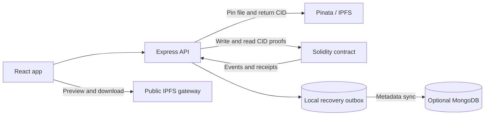

# ProofChain

ProofChain creates a timestamped blockchain proof that a specific set of document bytes existed. The application pins the file to IPFS, gets its content identifier (CID), then records that CID, the transaction sender, and the block timestamp in a Solidity contract. Anyone can verify the CID directly against the contract.

> A matching CID proves that the same bytes were anchored by a blockchain transaction. It does not prove who originally created the file, who owns it, or whether its contents are true.

## What it does

- **Upload:** Pin a document to IPFS and anchor its CID on the configured chain.
- **Verify:** Check a CID on-chain, or submit a file to recompute its CID and check that result.
- **History:** Browse, search, filter, and paginate records for the active contract deployment.
- **Receipts:** Show transaction hash, uploader, block, timestamp, gas used, and transaction fee when available.
- **Recovery:** Keep confirmed upload metadata in a local outbox so a temporary MongoDB outage does not hide a successful proof.
- **Demo protections:** Apply file-size and rate limits, validate requests, restrict browser origins, and sandbox document previews.

## Architecture



The backend signer submits blockchain transactions. Connecting MetaMask is optional and only displays the browser wallet address; it does not pay for uploads. The contract stores CIDs, signer addresses, and timestamps, not document bytes or credentials. IPFS files are publicly accessible, so upload only material intended for public access.

## Requirements

- Node.js 20.15 or later
- npm
- A Pinata JWT with permission to pin files
- Optional MongoDB connection string (local demo history also uses a disk-backed recovery queue)
- MetaMask is optional

## Run locally

### Windows quick start

1. Run [`scripts/0_INSTALL_FIRST_TIME.bat`](scripts/0_INSTALL_FIRST_TIME.bat) to install dependencies.
2. Copy `backend/.env.example` to `backend/.env` and set `PINATA_JWT`. Set `MONGO_URI` only if using MongoDB.
3. Run [`scripts/1_START_ALL.bat`](scripts/1_START_ALL.bat).
4. Open [http://localhost:5173](http://localhost:5173). The API health endpoint is [http://127.0.0.1:5000/api/health](http://127.0.0.1:5000/api/health).

### Manual start

Install dependencies in each application directory:

```powershell
cd blockchain; npm ci
cd ..\backend; npm ci
cd ..\frontend; npm ci
```

Then start these processes in separate terminals, from the repository root:

| Terminal | Command | Purpose |
| --- | --- | --- |
| 1 | `cd blockchain; npm run node -- --hostname 127.0.0.1` | Local Hardhat chain |
| 2 | `cd blockchain; npm run deploy:local` | Deploy the contract and write local backend settings |
| 3 | `cd backend; npm start` | API at `127.0.0.1:5000` |
| 4 | `cd frontend; npm run dev` | Vite app at `localhost:5173` |

The Hardhat ledger is in memory. Restarting the chain requires redeployment; proofs from its previous in-memory history will no longer be available on that local chain.

## Try the demo

1. Upload a sample from [`demo-documents/`](demo-documents/). These sample files are pinned publicly when uploaded.
2. Open **History** and try searching by filename, uploader, CID, or UTC date. Open a record to preview or download the IPFS file.
3. Verify the original file or its CID. A modified file should produce a different CID and no matching proof.
4. If MongoDB is unavailable, the API can still return a confirmed proof and show locally queued metadata. The local outbox is stored in `backend/data/outbox` by default.

The local chain is intended for development and demos. Do not expose the Hardhat node or Vite dev server to the public internet.

## Sepolia testnet

The project includes deployment and benchmark scripts for Sepolia. Public testnet measurements are currently pending; see [`reports/GAS_RESULTS.md`](reports/GAS_RESULTS.md).

1. Copy `blockchain/.env.example` to `blockchain/.env` and configure `SEPOLIA_RPC_URL` and `SEPOLIA_PRIVATE_KEY` with a dedicated test wallet. Never use a wallet that holds real funds.
2. Fund it with Sepolia test ETH.
3. From `blockchain`, run `npm run deploy:sepolia`.
4. Start the backend with the generated Sepolia profile: in PowerShell, from `backend`, run `$env:ENV_FILE = '.env.sepolia'; npm start`.
5. Start the frontend and confirm its network badge before uploading. Sepolia uploads publish files to IPFS and consume test ETH.

See the [Sepolia deployment script](scripts/6_DEPLOY_SEPOLIA.bat), [API profile script](scripts/7_START_SEPOLIA_API.bat), and [benchmark script](scripts/8_BENCHMARK_SEPOLIA.bat) for Windows shortcuts.

## Development commands

```bash
# Contract compile and tests
cd blockchain && npm test

# API tests
cd backend && npm test

# Frontend production build
cd frontend && npm run build
```

[`scripts/4_RUN_TESTS.bat`](scripts/4_RUN_TESTS.bat) runs the contract and API tests and builds the frontend on Windows. No test or build result is implied by this README.

## Project layout

| Path | Contents |
| --- | --- |
| `frontend/` | React and Vite web app |
| `backend/` | Express API, IPFS integration, chain access, and metadata recovery |
| `blockchain/` | Solidity contract, Hardhat configuration, deployment and benchmark scripts |
| `demo-documents/` | Synthetic files for local demonstrations |
| `docs/` | System architecture and design notes |
| `reports/` | Reliability, gas, and dependency audit reports |
| `scripts/` | Windows setup, run, deploy, and maintenance helpers |

## Documentation

- [Architecture](docs/ARCHITECTURE.md)
- [Windows demo manual](PROOFCHAIN_MANUAL.md)
- [Reliability and gas report](reports/RELIABILITY_AND_GAS.md)
- [Gas results](reports/GAS_RESULTS.md)

## Security and deployment notes

- Keep `.env` files and all credentials out of Git. The checked-in `.env.example` files are templates; fill them in locally.
- Never deploy with a public Hardhat development key. Use a dedicated test wallet for Sepolia.
- Before hosting beyond a local demo, put the frontend and API behind a production web server, configure exact CORS origins, use persistent storage for the recovery outbox, and add authentication and authorization for writes. CORS and per-IP rate limits are not authentication.
- See [Architecture](docs/ARCHITECTURE.md) for failure boundaries and security details.
