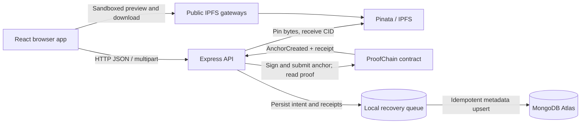
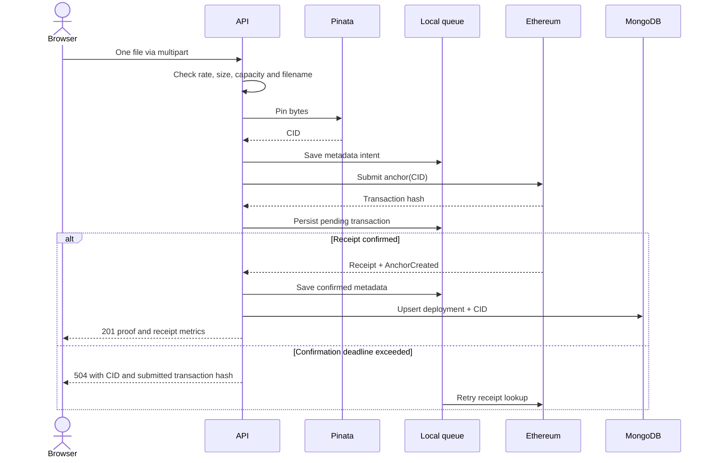

# ProofChain architecture

The blockchain records a proof of existence for a CID. IPFS provides the file bytes, and MongoDB provides searchable metadata. Verification reads the chain directly. The file and database can be unavailable independently of the proof.

The backend signer submits transactions. The MetaMask connection is optional and identifies the browser's wallet for display. Anyone can call the contract directly; the CID, transaction sender and timestamp are public. No files or credentials are stored on-chain. Filenames and MIME types are informational metadata, separate from the cryptographic proof.

## Storage and failure boundaries

- Recovery entries live in `backend/data/outbox` by default. The API records the intent before sending a transaction, then records the hash as soon as the RPC returns it. The background worker checks pending receipts, checks the event and CID, and retries MongoDB sync. The queue is designed for one API process with a persistent local volume.
- A successful receipt is shown even if MongoDB is down. History then shows available local records and indicates it is partial. Pinata may already have pinned a file if the chain step fails. If the process crashes between broadcast and saving the hash, on-chain verification remains possible by CID, but automatic metadata recovery cannot be guaranteed.
- MongoDB's `documents_v2` collection uses unique `(networkKey, cid)` and history indexes. `networkKey` contains chain ID, contract address and deployment transaction hash. The original `documents` collection is preserved. History shows the active deployment only, avoiding stale results when a local chain is restarted or the backend switches networks.
- The API runs one signer queue to avoid concurrent nonce conflicts. The upload limit and shared rate/capacity controls apply to file upload and file verification. A CID-only verification bypasses Pinata. File verification uses the same Pinata import settings as upload.
- History performs bounded, literal search and pagination on the server. It combines queued records with indexed database results, sorted by blockchain timestamp. Date filters use UTC and include both selected calendar dates.

## Contract security review

`anchor` bounds the CID to 128 bytes, rejects empty and duplicate values, and records `msg.sender` and `block.timestamp`. `AnchorCreated` emits the CID, indexed uploader, and timestamp on each successful anchor. The contract makes no external calls, handles no ETH, has no admin or upgrade functions, and never edits an existing anchor. No reentrancy guard or admin access role is needed for these entry points. CID syntax is validated at the API boundary; direct contract callers can supply other strings within the length bound. Distinct textual CID encodings are distinct contract keys, so verification should use the CID returned at upload.

## API boundaries

Helmet sets security headers; CORS accepts only the configured origins. The rate limiter controls traffic by IP within one process. File writes are for a controlled demo and require authentication before a public deployment. The backend binds to loopback by default. The frontend receives network identifiers, CIDs and transaction details; server secrets stay in the backend and deployment environment files. Errors expose allowlisted revert messages and safe service status, never raw provider request objects. Browser previews use a sandbox for PDF and text/HTML, and downloads use the [IPFS gateway's attachment parameters](https://docs.ipfs.tech/reference/http/gateway/).
